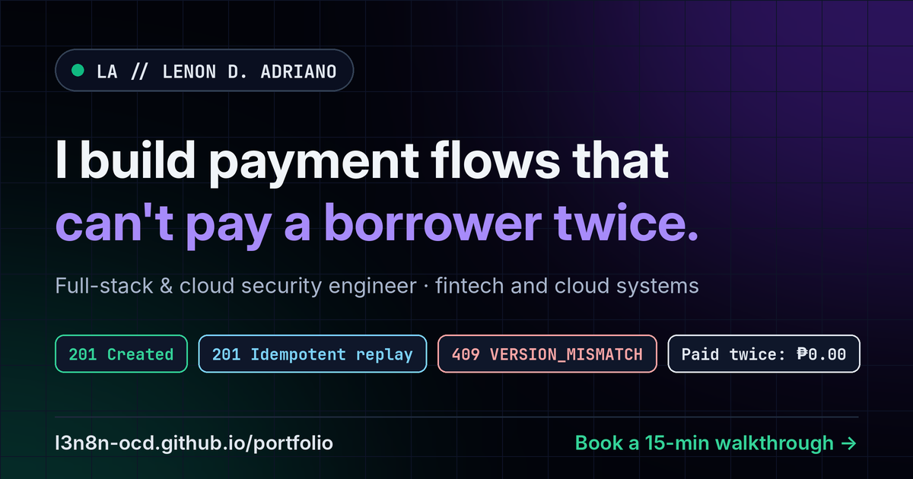
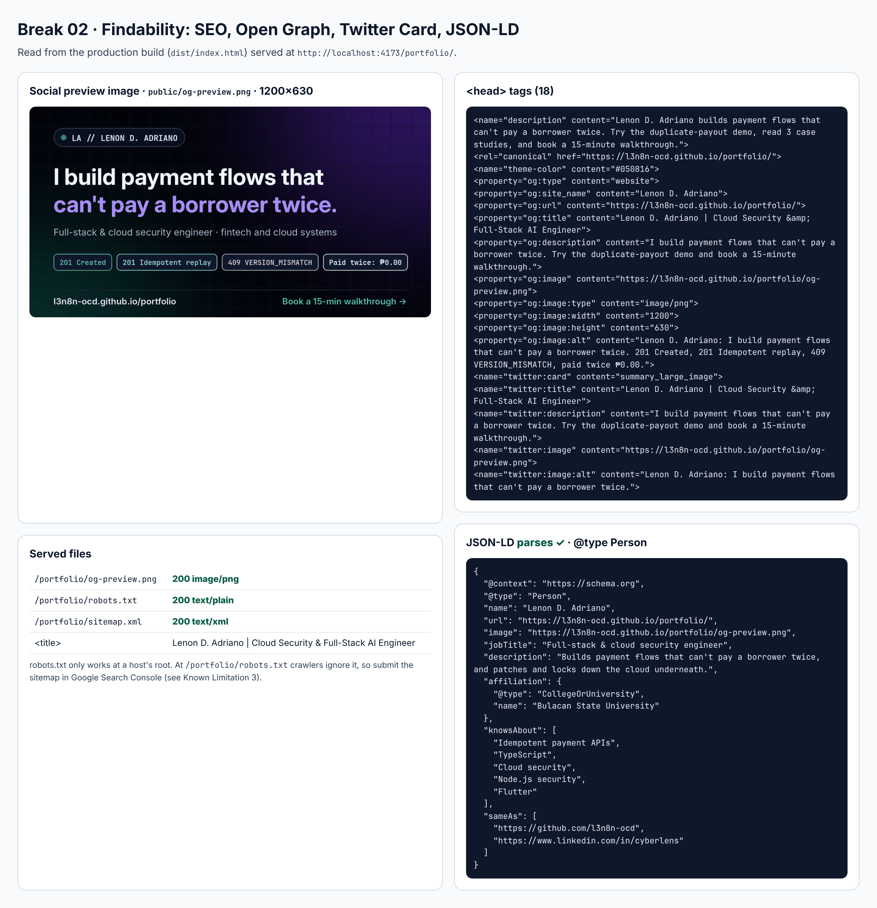
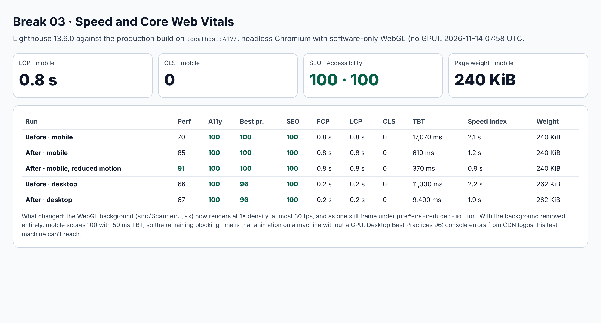
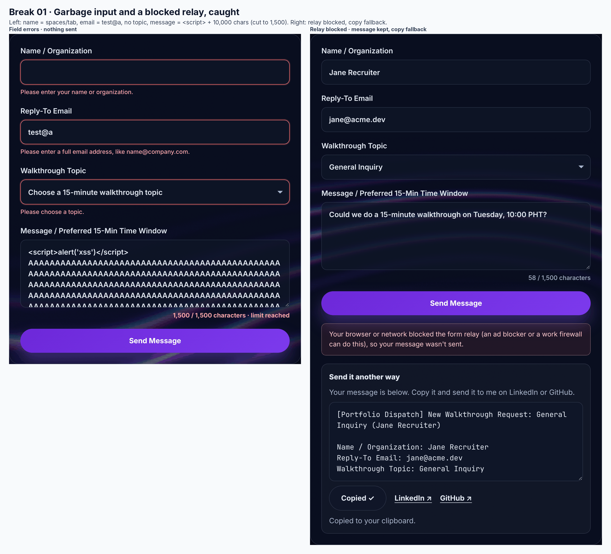
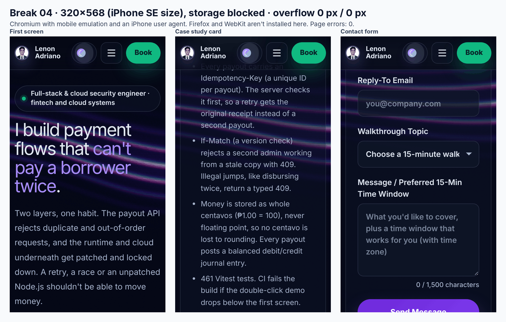

# Break Your Own Site: Edge Cases, Fixes and Known Limits

**Live:** https://l3n8n-ocd.github.io/portfolio/
**How it was tested:** a Playwright script ran each break against the production build (`npm run build && npm run preview`), first on the code as it was (commit `c62a782`), then after the fixes. Lighthouse 13.6.0 measured speed and SEO. All runs used headless Chromium; Firefox and WebKit aren't installed in this environment.

> **To fill before submitting:** Section 5 holds Clarence's own findings. Every `✍️ PASTE` block there needs his words, copied exactly.

---

## Section 1: Where it breaks (8 tests → Fix-Now or Known Limitation)

| # | Break attempt | What happened before | Verdict | After |
| --- | --- | --- | --- | --- |
| 1 | Name and message of only spaces and tabs | Caught: "Please enter your name…", 0 requests | Already safe | Unchanged |
| 2 | `test@a`, `user@localhost`, `a@b.c`, `x@@y.com`; `<script>alert('xss')</script>`; 400 emoji; a 10,000-character paste | `test@a`, `user@localhost`, `x@@y.com` rejected. **`a@b.c` accepted.** The 10,000-character paste sat in the box, and you only learned the 3,000 limit on submit. No script ran (React escapes text). | **Fix-Now 1** | All 4 bad emails rejected. Box stops at 1,500 characters with a live counter. |
| 3 | Double-click, two `requestSubmit()` calls in the same tick, Enter × 5 | 1 request each time (a `useRef` lock already existed) | Already safe | Still 1 request each (lock renamed `isSubmittingRef`) |
| 4a | Relay blocked (ad blocker / firewall, `net::ERR_BLOCKED_BY_CLIENT`) | Error text that **published the email address**, no way to keep the message | **Fix-Now 2** | Plain error, fields kept, "Send it another way" card with **Copy message** and LinkedIn/GitHub links |
| 4b | Relay never answers | **46 s** of "Sending..." before any message | **Fix-Now 2** | Error after **10 s**, same copy fallback |
| 5a | Storage blocked ("Block all cookies and site data") | **Blank page.** `localStorage.getItem` threw `SecurityError` during the first render. | **Fix-Now 4** | Page renders, no errors; theme just isn't remembered |
| 5b | 320×568 phone | 0 px overflow, but the header was **104 px tall** (name and title in 4 lines) | **Fix-Now 5** | 69 px header, 0 px overflow |
| 6 | Every link, and a shared link to `/portfolio/#contact` | All 6 anchors exist; all 11 external links have `noopener`. **`#contact` opened at the top of the page.** | **Fix-Now 5** | Lands on the contact form |
| 7 | Paste the URL into a chat app / search for it | No description, no Open Graph image, no canonical, no structured data; title "LA's Portfolio" | **Fix-Now 3** | 18 head tags, 1200×630 preview card, JSON-LD `Person`, `robots.txt`, `sitemap.xml` |
| 8 | Speed | Mobile performance 70, **17 s total blocking time** | Fix-Now (partial) + **Known Limitation** | Mobile 85 (0.61 s), reduced motion 91 |

Two of the five fixes in the original plan (whitespace-only input and double-submit) turned out to be already handled, so they're recorded as passes. Their slots went to two breaks the tests found instead: the `#contact` deep link and the cramped 320 px header.

---

## Section 2: The Fix-Nows

### Fix-Now 1 · Form input limits (`src/components/ContactDispatchForm.tsx`)

```diff
-const EMAIL_PATTERN = /^[^\s@]+@[^\s@]+\.[^\s@]+$/
+// local@domain.tld with a letters-only TLD of 2+ characters: rejects test@a,
+// user@localhost and a@b.c, which the browser's type="email" check lets through.
+const EMAIL_PATTERN = /^[^\s@]+@[^\s@.]+(?:\.[^\s@.]+)*\.[A-Za-z]{2,}$/
+const NAME_MAX = 100
+const EMAIL_MAX = 254
+const MESSAGE_MAX = 1500
```

- Every field is checked after `.trim()`, so whitespace-only input stays blocked.
- `maxLength` on name (100), email (254) and message (1,500), plus a counter under the message: "1,500 / 1,500 characters · limit reached".
- Errors sit under each field, with `aria-invalid` and `aria-describedby`.

| Input | Before | After |
| --- | --- | --- |
| `a@b.c` | Accepted | "Please enter a full email address, like name@company.com." |
| 10,000-character paste | Accepted, rejected only on submit (over 3,000) | Box holds 1,500, counter shows the limit |

### Fix-Now 2 · Blocked or silent relay (`ContactDispatchForm.tsx`)

```diff
-const REQUEST_TIMEOUT_MS = 45_000
+// A relay that hasn't answered in 10 s is treated as blocked or down, and the
+// visitor gets the copy-and-send fallback instead of a spinner.
+const REQUEST_TIMEOUT_MS = 10_000
```

- On a block, a timeout or a rejected request, the fields stay filled, and a **Send it another way** card shows the full message as text.
- **Copy message** uses the Clipboard API. If that's blocked, it selects the text and tries `execCommand('copy')`. If that fails too, it tells the visitor to press Ctrl+C. Checked: the clipboard held `[Portfolio Dispatch] New Walkthrough Request: General Inquiry (…)`.
- The fallback points to LinkedIn and GitHub, not an email address. `CLAUDE.md` says the site never publishes one, so the address was also removed from the contact section and from every error message.
- The `isSubmittingRef` lock stays: 1 request for a double-click, two same-tick submits, or Enter × 5.

| Case | Before | After |
| --- | --- | --- |
| Relay never answers | 46 s on "Sending..." | Error after 10 s, copy fallback |
| Relay blocked | Error with an email address | Error, fields kept, copy fallback |
| Email address on the page | Yes (contact section and errors) | No |

### Fix-Now 3 · Findability and link previews (`index.html`, `public/`)

- `<title>Lenon D. Adriano | Cloud Security & Full-Stack AI Engineer</title>`, a meta description and `<link rel="canonical">`.
- 10 Open Graph tags and 5 Twitter Card tags (`summary_large_image`), all pointing at `https://l3n8n-ocd.github.io/portfolio/og-preview.png`.
- `public/og-preview.png`: 1200×630, drawn in Inter and JetBrains Mono on `#050816`.
- JSON-LD `Person`: name, URL, job title, Bulacan State University, and `sameAs` GitHub and LinkedIn. Checked that it parses.
- `public/robots.txt` and `public/sitemap.xml`, both served with HTTP 200 under `/portfolio/`.



### Fix-Now 4 · Blocked storage blanked the page (`src/hooks/useTheme.ts`)

```diff
-  const [theme, setTheme] = useState(() => localStorage.getItem('portfolio-theme') || 'dark')
+  const { theme, toggleTheme } = useTheme()
```

```ts
function readStoredTheme(): Theme {
  try {
    return window.localStorage.getItem(STORAGE_KEY) === 'light' ? 'light' : 'dark'
  } catch {
    return 'dark'
  }
}
```

The write is guarded too. Test: `window.localStorage` replaced with a getter that throws `SecurityError`. Before: 0 elements under `#root` and the page error "The operation is insecure.". After: the page renders (about 5,500 characters of text) with no errors.

### Fix-Now 5 · Narrow phones and deep links (`src/App.css`, `src/hooks/useHashScrollOnLoad.ts`)

- **320 px header:** under 360 px the "Cloud | DevOps | Security Engineer" line is hidden. Header: 104 px → 69 px. Overflow: 0 px at 320, 360, 375, 390, 768 and 1280.
- **`#contact` deep link:** the browser looks for the anchor before React has drawn it and doesn't look again. `useHashScrollOnLoad` scrolls to it once the app mounts. Before: `scrollY` stayed 0 for 3 s. After: the contact form is at the top of the screen.

### Speed fix (partial) · WebGL background (`src/Scanner.jsx`)

Lighthouse showed 17 s of total blocking time on mobile, so I ran it again with the animated background removed: performance 100 and 50 ms blocking time. The background now:
- renders at 1× pixel density instead of up to 2×;
- draws at most 30 frames a second;
- draws one still frame, in the right colours, when the system asks for reduced motion.

It already paused when the tab is hidden or the canvas is off-screen.

---

## Section 3: Known limitations, named plainly

### 1 · The contact form depends on a free third-party relay

GitHub Pages serves static files only, so there's no server of mine to send email. The form posts to FormSubmit.co. A firewall, an ad blocker or a FormSubmit outage stops it.

- **What I chose:** catch the failure fast (10 s), keep what the visitor typed, and give them a one-click copy plus LinkedIn and GitHub. The alternative is a paid backend I'd have to run and secure.
- **The cost:** a relay that's just slow, not down, can still deliver after the 10 s cut-off. The message tells the visitor to give it a minute before sending it another way, but a duplicate is possible.

### 2 · The hero's "Try to pay a borrower twice" panel is a simulation

It runs in the browser so it works instantly on GitHub Pages. A refresh resets it. The status codes mirror the real API (`disbursementServer.ts` in `l3n8n-ocd/microcredit-api`), and the panel says so and links to the real engine at https://microcredit-api-beta.vercel.app.

### 3 · Search indexing on a `github.io/portfolio` sub-path is slow, and `robots.txt` there is ignored

- Crawlers only read `robots.txt` at a host's root, `https://l3n8n-ocd.github.io/robots.txt`. That file would have to come from the `l3n8n-ocd.github.io` repo, which doesn't exist. The copy at `/portfolio/robots.txt` is harmless but unused.
- The sitemap has to be submitted by hand: Google Search Console → add `https://l3n8n-ocd.github.io/portfolio/` as a URL-prefix property → Sitemaps → `sitemap.xml`.
- A new sub-path site can take days to weeks to appear in search. A custom domain would fix both points; it isn't bought.

### Also measured, not fixed

- **Desktop performance is 67.** The full-screen WebGL background still costs about 9.5 s of blocking time on a machine with no GPU (Lighthouse's desktop run here). Real GPUs draw it far more cheaply, but I couldn't measure one in this environment. Removing the animation would give 100; I kept it for now as part of the site's look.
- **Only Chromium was tested.** Firefox and WebKit (Safari) aren't installed here. The 320 px run used Chromium with an iPhone user agent and touch emulation. Opening the site on a real iPhone in Safari is still to do.
- **What the email looks like:** the form sends plain text, and React never renders it as HTML on the site. Whether FormSubmit escapes `<script>` in the email it sends hasn't been checked; that needs one real test submission.
- **Link previews in real apps:** the tags and image are correct in the build. LinkedIn, Discord and Messenger cache previews, so check after the deploy, for example with LinkedIn's Post Inspector.

---

## Section 4: Findability, SEO and speed

### `<head>` tags in the build

```html
<title>Lenon D. Adriano | Cloud Security &amp; Full-Stack AI Engineer</title>
<meta name="description" content="Lenon D. Adriano builds payment flows that can't pay a borrower twice. Try the duplicate-payout demo, read 3 case studies, and book a 15-minute walkthrough." />
<link rel="canonical" href="https://l3n8n-ocd.github.io/portfolio/" />
<meta property="og:type" content="website" />
<meta property="og:url" content="https://l3n8n-ocd.github.io/portfolio/" />
<meta property="og:image" content="https://l3n8n-ocd.github.io/portfolio/og-preview.png" />
<meta property="og:image:width" content="1200" />
<meta property="og:image:height" content="630" />
<meta name="twitter:card" content="summary_large_image" />
<script type="application/ld+json">{ "@type": "Person", "name": "Lenon D. Adriano", ... }</script>
```

The full list (18 tags) and the parsed JSON-LD:



### Speed (Lighthouse 13.6.0, production build, headless Chromium without a GPU)

| Run | Perf | Access. | Best pr. | SEO | FCP | LCP | CLS | TBT | Weight |
| --- | --- | --- | --- | --- | --- | --- | --- | --- | --- |
| Before · mobile | 70 | 100 | 100 | 100 | 0.8 s | 0.8 s | 0 | 17,070 ms | 240 KiB |
| **After · mobile** | **85** | **100** | **100** | **100** | **0.8 s** | **0.8 s** | **0** | **610 ms** | **240 KiB** |
| After · mobile, reduced motion | 91 | 100 | 100 | 100 | 0.8 s | 0.8 s | 0 | 370 ms | 240 KiB |
| Before · desktop | 66 | 100 | 96 | 100 | 0.2 s | 0.2 s | 0 | 11,300 ms | 262 KiB |
| After · desktop | 67 | 100 | 96 | 100 | 0.2 s | 0.2 s | 0 | 9,490 ms | 262 KiB |

Desktop Best Practices is 96 because the skill logos come from `cdn.jsdelivr.net`, which this test machine can't reach, so they log console errors. These numbers come from `localhost`, not the live site, which this environment can't reach. The JavaScript bundle is 369 KB before compression.



### Evidence





---

## Section 5: Hardening review with Clarence Mari V. Clemente

Clarence tried to break the live site after the fixes were deployed: garbage and double-click form input, and the link preview in a chat app.

**What he tried**

> ✍️ PASTE: the inputs, devices and apps he used.

**What he found (his words)**

1. ✍️ PASTE
2. ✍️ PASTE
3. ✍️ PASTE

**Sorted**

| # | Finding | Fix-Now or Known Limitation | What I did | Re-checked |
| --- | --- | --- | --- | --- |
| C1 | ✍️ | ✍️ | ✍️ | ✍️ |
| C2 | ✍️ | ✍️ | ✍️ | ✍️ |
| C3 | ✍️ | ✍️ | ✍️ | ✍️ |
