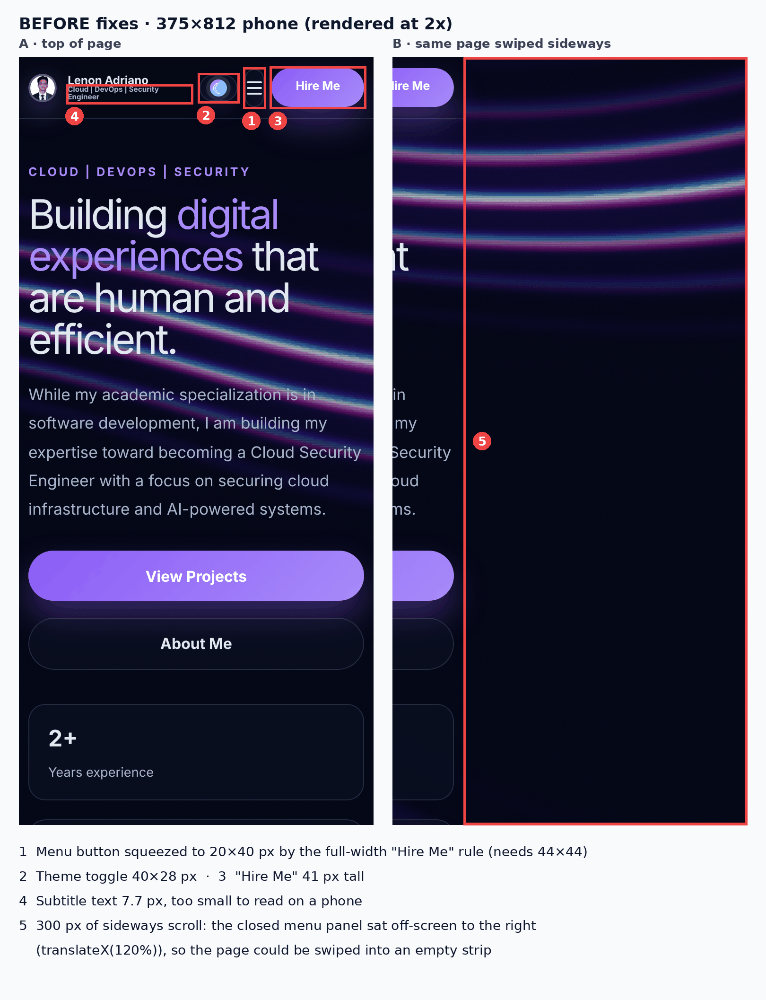
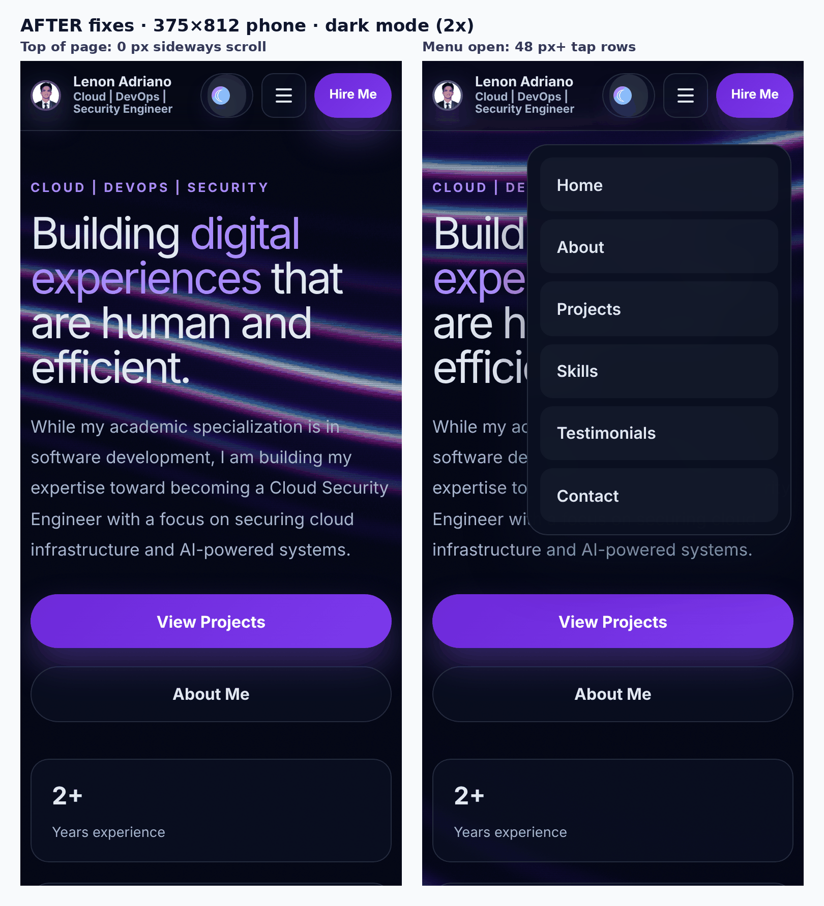
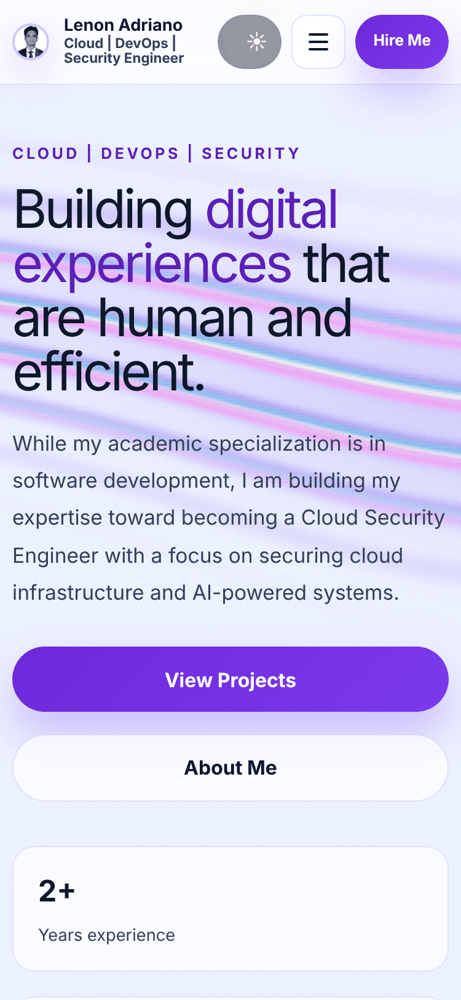
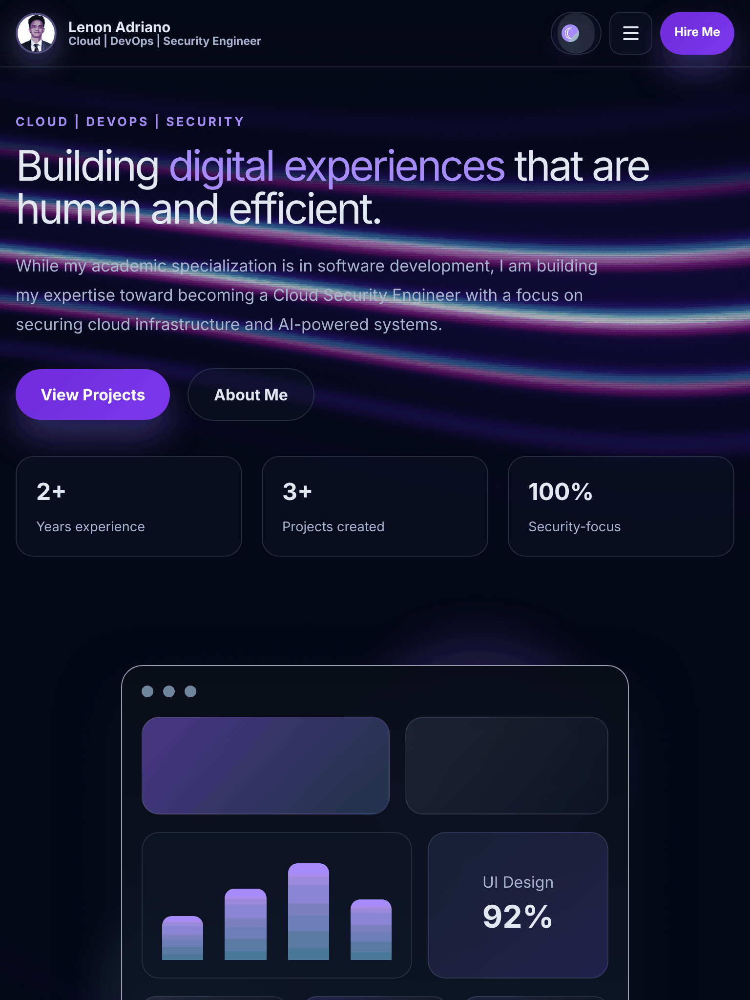
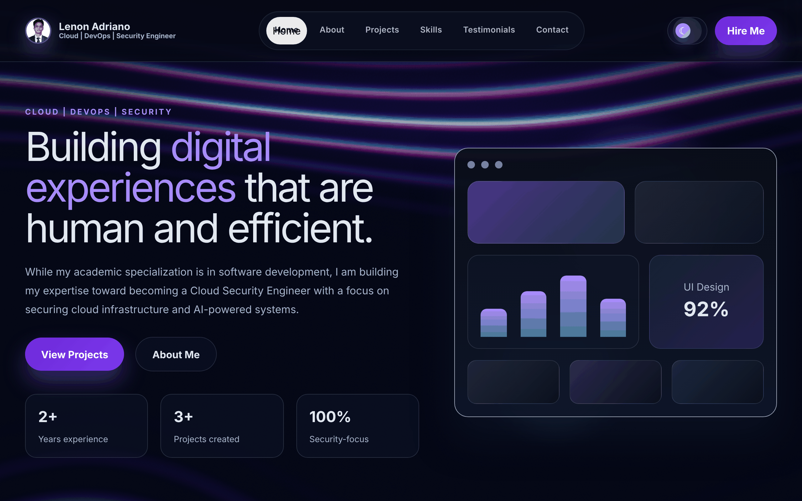

# Open It on Your Phone: Mobile Fix Log

**Live site:** https://l3n8n-ocd.github.io/portfolio/
**Tested widths:** 320, 375, 390 (phones) · 768 (tablet) · 1280 (desktop), dark and light mode
**How it was measured:** a Playwright script loaded the production build at each width and measured horizontal overflow (`scrollWidth − innerWidth`), the size of every visible link, button and input, font sizes and line heights, text contrast, image sizes and every link. The numbers below come from that script, before and after the fixes.

---

## Section 1: Summary

On a phone, the portfolio could be swiped 300 px sideways into an empty strip. The menu button was squashed to 20 px wide, three header controls were smaller than a fingertip, and the subtitle under my name was 7.7 px. In light mode some purple labels failed contrast, and the images were up to 2,000 px wide when shown at about 350 px.

After the fixes:

| Check | Before | After |
| --- | --- | --- |
| Sideways scroll at 375 / 390 / 768 px | 300 px | **0 px** (also 0 px at 320 and 1280) |
| Tap targets under 44×44 px | 3 on phones, 7 on desktop | **0** at every width |
| Smallest text on a phone | 7.7 px | **11.2 px** (body copy 16 px, line height 1.8) |
| Lowest text contrast in light mode | 3.78:1 (fails AA) | **8.02:1** (AAA) |
| Image weight on a phone | 439 KB of JPEG | **65–90 KB** of WebP (largest file 27.6 KB) |
| In-page links | 6 targets | 6 / 6 resolve |

---

## Section 2: The fix log (6 problems → concrete changes)

### Copy-paste summary

1. **Mobile header and tap targets:** the menu button was squeezed to 20×40 px, the theme toggle was 40×28 px, "Hire Me" was 41 px tall and the desktop nav links were 31 px tall. Every control is now at least 44×44 px, the menu rows are 53 px tall, the menu button says "Open/Close navigation menu" to screen readers, and the open menu is now solid instead of showing the page through it.
2. **Sideways scroll:** the closed menu panel was parked off-screen with `translateX(120%)`, which added 300 px of horizontal scroll on phones and tablets. It now hides in place, and `overflow-x: clip` on the page wrapper stops anything else causing it. 0 px at 320–1280 px.
3. **Form zoom on iPhone:** checked, and it was already fine: inputs were 16 px and 55 px tall, so iOS doesn't zoom. I pinned that with `font-size: max(16px, 1rem)` and `min-height: 48px` so a later style change can't undo it.
4. **Readability and contrast:** the subtitle went from 7.7 to 11.2 px, the skill chips from 14 px to 16 px, and project labels from 11.5 to 12.8 px. Light mode's purple labels went from 3.8:1 to 8.0:1 and grey body text from 6.8:1 to 9.2:1. The main button's white text went from 2.7:1 to at least 5.7:1. Dark mode text was already 7:1 or better.
5. **Images:** 439 KB of 1,000–2,000 px JPEGs were replaced with WebP files sized for their slots (largest 27.6 KB). Project images use `srcset`, so 1× screens get 640 px and Retina phones get 1,200 px. Every photo and diagram has `width`/`height`, and everything below the first screen uses `loading="lazy"` and `decoding="async"`.
6. **Links:** all 9 in-page links point at sections that exist. The 3 external "Open Project" links open in a new tab with `rel="noopener noreferrer"`. Their live status still needs checking from a phone (see the table below).

### 1. Mobile header crowding and small tap targets

| | Before | After |
| --- | --- | --- |
| Menu button (≤960 px) | **20×40 px**: a `width: 100%` rule meant for full-width buttons also hit "Hire Me" and squeezed the menu button | 44×44 px, `flex-shrink: 0`; "Hire Me" keeps `width: auto` |
| Theme toggle | 40×28 px (phone), 64×36 px (desktop) | 52×44 px (phone), 64×44 px (desktop) |
| "Hire Me" | 98×41 px | 44 px tall |
| Desktop nav links | 31 px tall | 44 px tall |
| Menu rows | n/a | 53 px tall; tapping one closes the menu and jumps to the section |
| Menu button label | "Toggle navigation menu" | "Open / Close navigation menu" plus `aria-expanded` and `aria-controls="mobile-nav-panel"` |
| Open menu | Hero text showed through it. The top bar's `backdrop-filter` made it the containing block for the fixed menu. | Blur moved to `.topbar::before`; the menu background is 97% opaque. The top bar looks and sticks the same. |

Files: `src/components/Navbar.jsx`, `src/App.css`.

### 2. Horizontal overflow

| | Before | After |
| --- | --- | --- |
| Cause | `.mobile-nav-panel { position: fixed; transform: translateX(120%) }` put a 260 px panel off the right edge while closed. Browsers count that as scrollable width. | Closed state is `translateY(-8px)` + `opacity: 0` + `visibility: hidden`, so it stays inside the screen |
| Guardrail | none | `.portfolio-page { overflow-x: clip }`. `clip` rather than `hidden`, because `hidden` would stop the sticky top bar from sticking. |
| Long strings | email address could not wrap | `overflow-wrap: anywhere` on contact details and footer |
| Result | 300 px at 375, 390 and 768 px | **0 px** at 320, 375, 390, 768 and 1280 px, with the menu open or closed |

Also removed: a duplicated pair of `@media (max-width: 580px)` / `(max-width: 420px)` blocks (53 lines) in `App.css`.

The site has no code blocks, diffs or monospace badges, so the code-overflow part of the brief had nothing to fix. The skills logo strip is wider than the screen on purpose (it scrolls), and its container already clips it.

### 3. Form inputs and iOS zoom

iOS Safari zooms into any input with text smaller than 16 px. Measured before any change:

| Field | Font size | Height |
| --- | --- | --- |
| Name, Reply-To Email, Topic | 16 px | 55 px |
| Message | 16 px | 151 px |

There was no zoom problem. To stop a future style change from bringing one back, `ContactDispatchForm.tsx`'s inputs now have `font-size: max(16px, 1rem)` and `min-height: 48px` in `App.css`.

### 4. Readability and contrast

Text sizes on a 375 px phone:

| Element | Before | After |
| --- | --- | --- |
| Subtitle under my name ("Cloud \| DevOps \| Security Engineer") | 7.7 px | 11.2 px |
| Skill chips (About section) | 14.1 px, line height 1.25 | 16 px, line height 1.4 |
| Project category label | 11.5 px | 12.8 px |
| Body paragraphs | 16 px, line height 1.8 | unchanged (already above 1.65) |

Contrast, measured against the solid page and card colours (the animated background lines move, so they can't be measured exactly):

| Text | Mode | Before | After |
| --- | --- | --- | --- |
| Section labels ("ABOUT", "PROJECTS"…), project category | Light | #8b5cf6: **3.78:1 / 4.09:1** ✗ | #5b21b6: **8.02:1** |
| Body and secondary text | Light | #475569: 6.76:1 | #334155: **9.24:1** |
| White text on main buttons | Both | gradient ended at #a78bfa: **2.72:1** ✗ | #6d28d9 → #7c3aed: **7.10:1 → 5.70:1** |
| Body and secondary text | Dark | #a8b5cc: 9.23–9.64:1 | unchanged |
| Purple labels | Dark | #a78bfa: 7.02–7.33:1 | unchanged |

Dark mode already met AAA (7:1) for every text style checked, so it needed no colour changes.

### 5. Images: size, sharpness and layout shift

| Image | Before | After |
| --- | --- | --- |
| S3 diagram | 1944×908 JPEG, 47.1 KB | WebP 640 w (4.8 KB) + 1200 w (9.2 KB) |
| IAM diagram | 1742×1346 JPEG, 98.2 KB | WebP 640 w (15.1 KB) + 1200 w (27.6 KB) |
| VPC diagram | 989×811 JPEG, 56.0 KB | WebP 640 w (13.9 KB) + 989 w (21.7 KB) |
| Portrait | 1007×1025 JPEG, 64.6 KB (also used as the 42 px header avatar) | WebP 800 px (18.0 KB) + 128 px avatar (2.0 KB, inlined) |
| Testimonial avatars (shown at 44 px) | 3 JPEGs, 25.9–77.8 KB | 132 px WebP, 3.3–4.1 KB |
| **Total downloaded on a phone** | **439 KB** | **89.5 KB** on a 2–3× screen, **64.8 KB** on a 1× screen |

- `srcset` + `sizes` on project images: a 3× iPhone gets the 1200 px file (checked); a 1× laptop gets the 640 px file.
- Every photo and diagram has `width` and `height`, so the browser reserves the space before the image loads (the cards already had a fixed `aspect-ratio`).
- `loading="lazy"` and `decoding="async"` on everything below the first screen; the header avatar loads immediately.
- Sources stay in `src/assets/`; the WebP files are in `src/assets/optimized/`.

### 6. Links

| Link | Where | Check |
| --- | --- | --- |
| `#home`, `#about`, `#projects`, `#skills`, `#testimonials`, `#contact` | Desktop nav, phone menu | ✓ all 6 sections exist; tapping a phone menu item closes the menu and jumps there |
| `#contact` | "Hire Me" | ✓ |
| `#projects`, `#about` | "View Projects", "About Me" | ✓ |
| `nextwork.ai/…/aws-host-a-website-on-s3` | S3 project "Open Project" | `target="_blank"`, `rel="noopener noreferrer"` · status: ☐ check on phone |
| `nextwork.ai/…/aws-security-iam` | IAM project "Open Project" | `target="_blank"`, `rel="noopener noreferrer"` · status: ☐ check on phone |
| `nextwork.ai/…/aws-networks-vpc` | VPC project "Open Project" | `target="_blank"`, `rel="noopener noreferrer"` · status: ☐ check on phone |

The build environment couldn't reach `nextwork.ai` or `cdn.jsdelivr.net` (which serves the skill logos), so those 3 links and 12 logos haven't been confirmed live. Tap each "Open Project" button on your phone and tick the boxes.

The site has no MicroCredit API demo, LinkedIn, CV or DNS walkthrough links, so there was nothing to check for those.

---

## Section 3: Before and after

### Before: 375×812 phone

Numbered problems: (1) squeezed menu button, (2) small theme toggle, (3) "Hire Me" under 44 px, (4) 7.7 px subtitle, (5) the empty strip you could swipe into.

### After: 375×812 phone, dark mode (page top and menu open)

### After: 375×812 phone, light mode

### After: 768×1024 tablet

### After: 1280×800 desktop

Screenshots are 2× captures of the given viewport sizes. The site's animated background lines are different in every frame.

### Still to do on a real phone

- [ ] Open https://l3n8n-ocd.github.io/portfolio/ on your phone and try to swipe sideways: the page shouldn't move.
- [ ] Open the menu, tap a section, and check it closes and scrolls there.
- [ ] Switch to light mode and back.
- [ ] Tap into the contact form: the page shouldn't zoom.
- [ ] Tap the 3 "Open Project" buttons and tick them in section 6.
