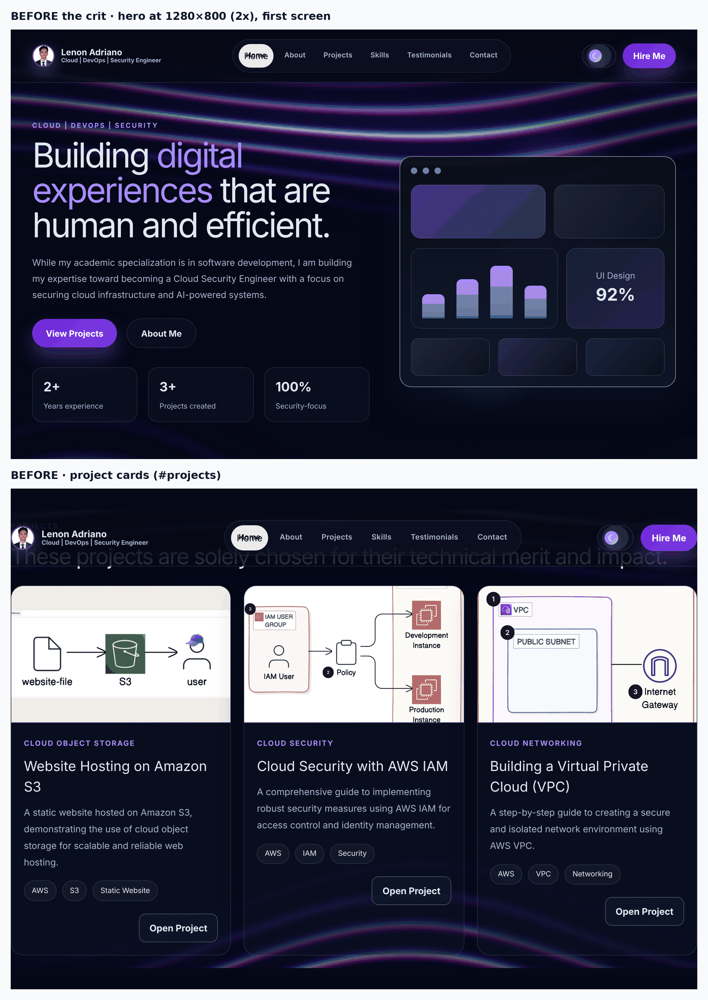
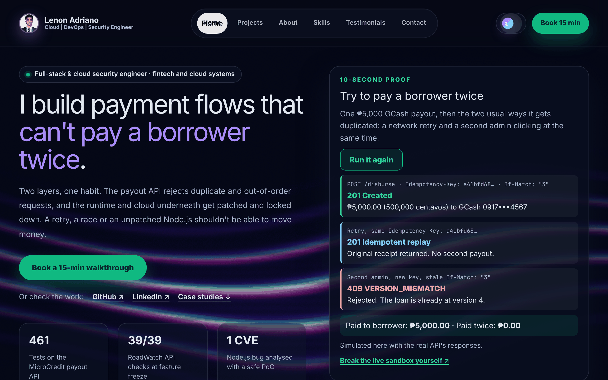
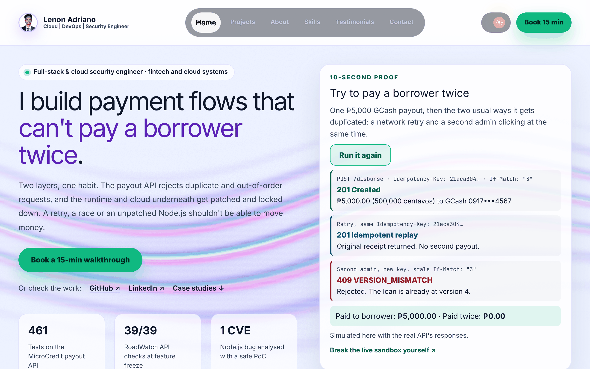
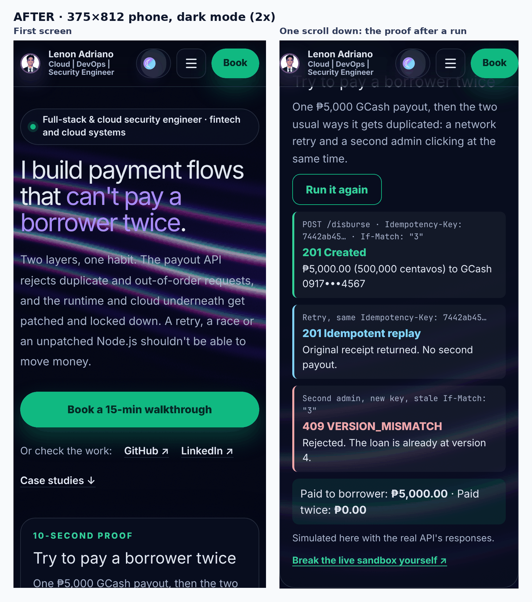
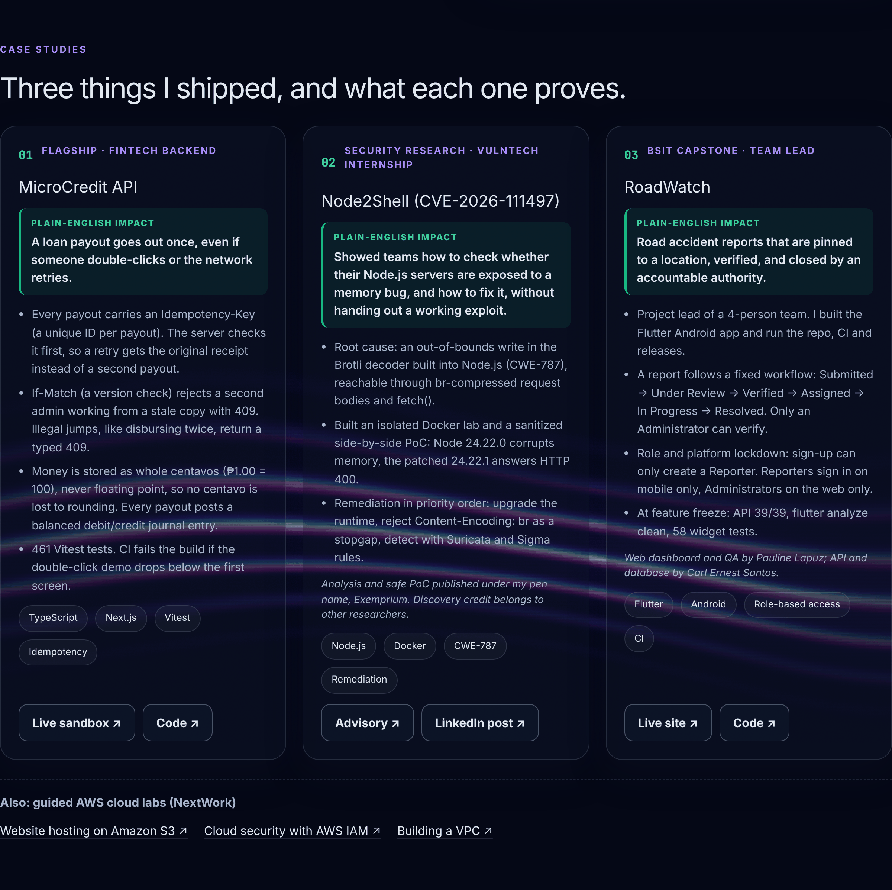

# Survive the Crit: Peer Review, Sort and Fixes

**Live site:** https://l3n8n-ocd.github.io/portfolio/
**Reviewer:** Clarence Mari V. Clemente (BSIT WMAD, System Analyst, academic collaborator)
**Changed files:** `src/components/Hero.tsx` (new), `src/components/CapstoneAndProjects.tsx` (new, replaces `Projects.jsx`), `src/components/Navbar.jsx`, `src/App.jsx`, `src/App.css`

> **To fill before submitting:** every block marked `✍️ PASTE` must hold Clarence's own words, copied exactly. Nothing in those blocks is pre-written.

---

## Section 1: The review request and the Chapter 1 Proof Statement

The site is reviewed against its real job, so the reviewer gets the Proof Statement first:

> **Chapter 1 Proof Statement**
> For an Engineering Manager at a seed-to-Series A lending or cloud-native startup, I prove I can ship race-condition-safe payment flows and security-hardened cloud systems that cannot pay a borrower twice—so they test my live MicroCredit API sandbox and book a 15-minute technical walkthrough.

The review request (edit it to match exactly what you sent):

> Hi Clarence! Could you review my portfolio for 10 minutes? Here's what it's supposed to do:
>
> *[Proof Statement above]*
>
> Please open https://l3n8n-ocd.github.io/portfolio/ and, before scrolling, answer two questions from your first ten seconds:
> 1. In ten seconds, what do I do?
> 2. Would you believe I'm good at it?
>
> Then tell me everything that confused you or didn't land, however small. I'll just write it down; I won't argue or explain. Thank you!

---

## Section 2: The two 10-second questions and the raw feedback

Recorded as said. I didn't explain, defend or correct anything during the review.

**Question 1: "In ten seconds, what do I do?"**

> ✍️ PASTE Clarence's exact answer here.

**Question 2: "Would you believe I'm good at it?"**

> ✍️ PASTE Clarence's exact answer here.

**Raw critique notes (in the order he gave them)**

1. ✍️ PASTE
2. ✍️ PASTE
3. ✍️ PASTE
4. ✍️ PASTE
5. ✍️ PASTE
6. ✍️ PASTE
7. ✍️ PASTE

---

## Section 3: Honest sort, Must-Fix now vs. Nice-to-Have later

A note is **Must-Fix** if it slows the 10-second answer to "what do I do?", stops the proof from landing, or pulls attention away from the one action (book a 15-minute walkthrough). Everything else is parked, so the site doesn't grow features nobody needs yet.

| # | Issue | Clarence's note | Sort | Why |
| --- | --- | --- | --- | --- |
| M1 | Two identities in the first screen: a generic "Cloud \| DevOps \| Security" label and a headline about "digital experiences" don't tell you how cloud security and payment systems connect | ✍️ note # | **Must-Fix** | Fails question 1: the visitor has to work out what I do instead of reading it |
| M2 | The proof is too far down: nothing on the first screen shows the duplicate-payout guard, so the claim has to be taken on trust until you scroll | ✍️ note # | **Must-Fix** | Fails question 2 in the first 10 seconds; the Proof Statement says "test my live sandbox" |
| M3 | The main call to action doesn't stand out: "View Projects", "About Me" and "Hire Me" look alike and none of them says "book a walkthrough" | ✍️ note # | **Must-Fix** | Dilutes the one action |
| M4 | Case cards need a plain-English line: terms like idempotency keys, If-Match and centavo ledgers lose a fast, non-fintech reader | ✍️ note # | **Must-Fix** | A skimming recruiter or manager doesn't get the outcome in 3 seconds |
| N1 | ✍️ | ✍️ note # | Nice-to-Have | ✍️ Doesn't block the core job; parked |
| N2 | ✍️ | ✍️ note # | Nice-to-Have | ✍️ Doesn't block the core job; parked |
| N3 | ✍️ | ✍️ note # | Nice-to-Have | ✍️ Doesn't block the core job; parked |

---

## Section 4: What changed on the live site

### Before

The hero and project cards as they were when reviewed (1280×800, dark mode):

### M1: One identity in the first 5 seconds

**Before:** `Cloud | DevOps | Security` label · "Building digital experiences that are human and efficient." · a paragraph about specializing in software development.

**After** (`src/components/Hero.tsx`):

- **Pill:** Full-stack & cloud security engineer · fintech and cloud systems
- **Headline:** I build payment flows that **can't pay a borrower twice**.
- **Bridge line:** Two layers, one habit. The payout API rejects duplicate and out-of-order requests, and the runtime and cloud underneath get patched and locked down. A retry, a race or an unpatched Node.js shouldn't be able to move money.
- **Stats:** "2+ years / 3+ projects / 100% security-focus" became numbers a reader can check: **461** tests on the MicroCredit payout API · **39/39** RoadWatch API checks · **1 CVE** analysed with a safe PoC.

### M2: The proof on the first screen

A **"Try to pay a borrower twice"** panel now sits in the hero, where a decorative dashboard mockup used to be. One click sends three requests:

| Request | Response | Result |
| --- | --- | --- |
| `POST /disburse` with a new `Idempotency-Key`, `If-Match: "3"` | `201 Created` | ₱5,000.00 (500,000 centavos) to GCash |
| Retry with the **same** `Idempotency-Key` | `201 Idempotent replay` | Original receipt returned, no second payout |
| Second admin, new key, **stale** `If-Match: "3"` | `409 VERSION_MISMATCH` | Rejected; the loan is already at version 4 |

Then: **Paid to borrower ₱5,000.00 · Paid twice ₱0.00**, and a link to break the live sandbox at https://microcredit-api-beta.vercel.app.

- The panel runs in the browser, and it says so. The status codes mirror the real API (`disbursementServer.ts` in `l3n8n-ocd/microcredit-api`). A same-key retry is **replayed with the original receipt (201)**, not rejected. The `409` is for the stale `If-Match`.
- At 1280×800, the whole panel, including the sandbox link, fits on the first screen.
- At 375×812, the panel's title shows at the bottom of the first screen and the button is one short scroll down. The headline and the walkthrough button keep the top of the screen.

### M3: One primary action

- The hero has **one** filled button: **Book a 15-min walkthrough** (→ `#contact`). It uses Verification Emerald `#10b981` with near-black text, which gives 5.97:1 contrast. White text on `#059669` would only reach 3.77:1 and fail WCAG AA.
- GitHub, LinkedIn and Case studies are now plain text links in a secondary row: "Or check the work: GitHub ↗ · LinkedIn ↗ · Case studies ↓".
- The nav button "Hire Me" became the same emerald **Book 15 min** ("Book" on phones under 480 px, so the header stays one row).
- "View Projects" and "About Me" are gone from the hero. The nav already links to both.

### M4: Plain-English outcome first on every case card

`src/components/CapstoneAndProjects.tsx` replaces the three AWS lab cards with three case studies. The case studies come straight after the hero, and the AWS labs stay as links underneath. Each card opens with a **Plain-English impact** line, and every technical term in the details gets a short gloss in brackets:

| Case | Plain-English impact |
| --- | --- |
| 01 · MicroCredit API | A loan payout goes out once, even if someone double-clicks or the network retries. |
| 02 · Node2Shell (CVE-2026-111497) | Showed teams how to check whether their Node.js servers are exposed to a memory bug, and how to fix it, without handing out a working exploit. |
| 03 · RoadWatch | Road accident reports that are pinned to a location, verified, and closed by an accountable authority. |

Examples of the glosses: "Idempotency-Key (a unique ID per payout)", "If-Match (a version check)", "whole centavos (₱1.00 = 100), never floating point". Credit lines stay on the cards: Node2Shell's discovery credit belongs to other researchers, and RoadWatch's web dashboard and API were built by teammates.

### Checked after the changes

- `npm run build` passes, and both new `.tsx` files pass a strict TypeScript check.
- No horizontal scroll and no tap target under 44 px at 375, 390, 768 and 1280 px.
- Text contrast in the new hero, proof panel and cards: 5.97:1 or higher in both themes (most 7:1+).

---

## Section 5: My reply to Clarence

**Draft** (send it, then replace this with what you actually sent):

> Thanks for the honest review, Clarence. You were right on all four points, and they're fixed on the live site now: https://l3n8n-ocd.github.io/portfolio/
>
> 1. **One identity:** the hero now says what I do in one line, "I build payment flows that can't pay a borrower twice", with a sentence underneath on how the payment and cloud-security sides connect.
> 2. **Proof on the first screen:** there's a "Try to pay a borrower twice" panel in the hero. One click shows the payout, the retry that gets replayed, and the second admin who gets a 409, with a link to the live sandbox.
> 3. **One main button:** "Book a 15-min walkthrough" is the only filled button. GitHub and LinkedIn are small text links under it.
> 4. **Plain English first:** each case card now opens with a one-line plain-English outcome, and the jargon has short explanations.
>
> I parked your other ideas ([N1], [N2], [N3]) for later, so the site stays focused for now. If you have 10 seconds, I'd love to know if question 1 is faster to answer now.
